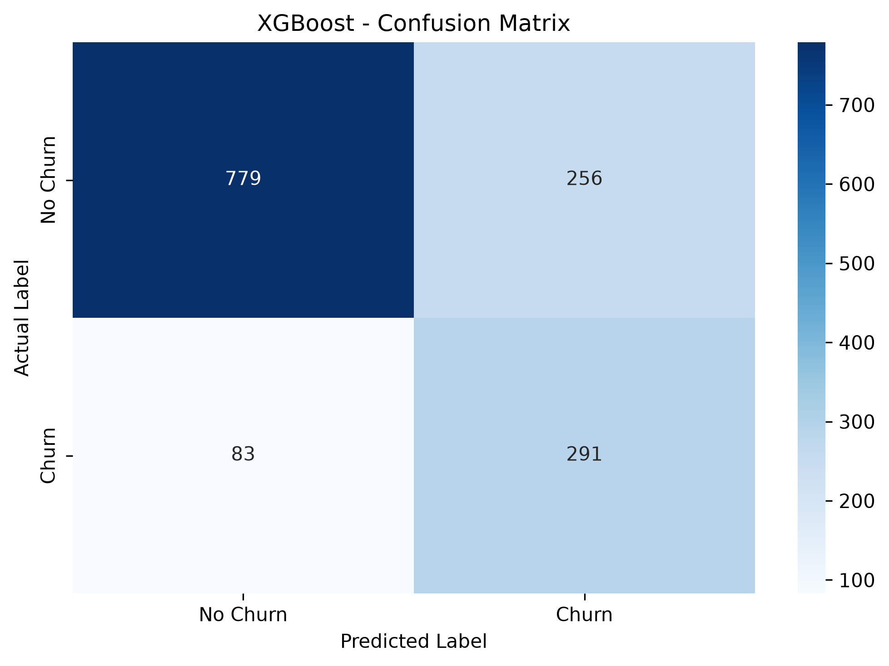
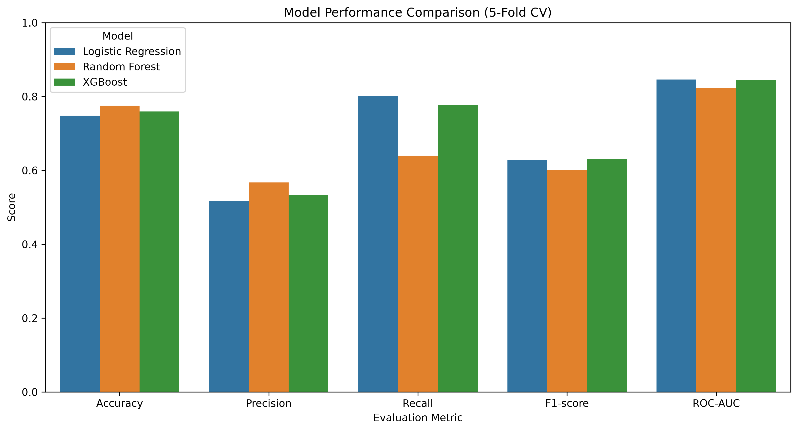
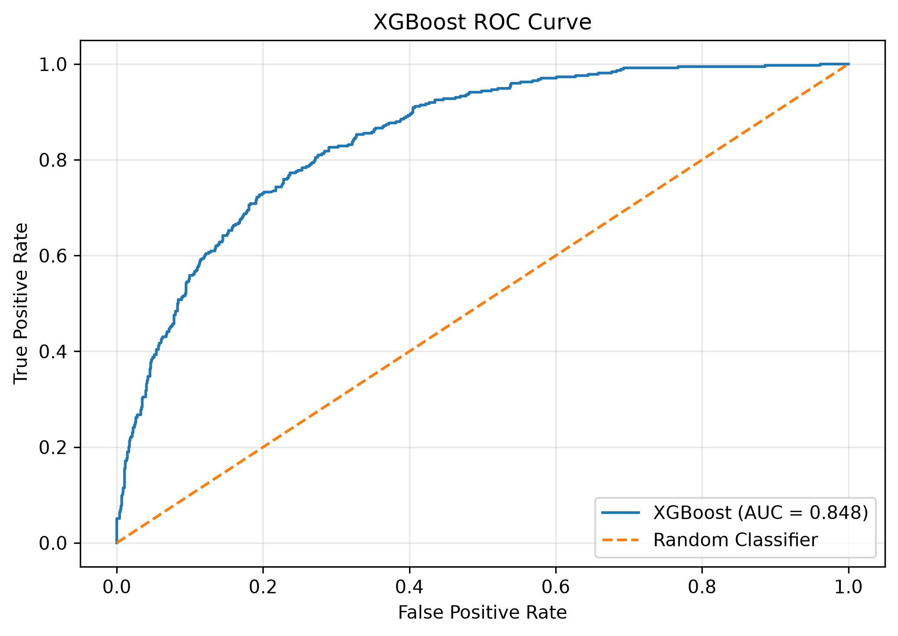

# Telco Customer Churn Prediction

A machine learning classification project that predicts whether a telecommunications customer is likely to leave a service provider.

This project was completed as part of the **Datheon Machine Learning & Data Science Internship**.

## 1. Project Overview

Customer churn is a major business challenge for telecommunications companies. Losing existing customers can reduce revenue and increase customer acquisition costs.

The objective of this project is to develop a machine learning model that identifies customers who are more likely to discontinue their subscriptions.

The project includes data preprocessing, exploratory data analysis, class imbalance handling, model comparison, hyperparameter tuning, threshold optimization, and a reusable prediction pipeline.

## 2. Dataset

**Dataset:** IBM Telco Customer Churn

The dataset contains 7,043 customer records and 21 columns, including customer demographics, subscribed services, account information, and churn status.

**Target variable:** `Churn`

- `Yes`: Customer left the company.
- `No`: Customer remained with the company.

The original dataset contains 5,174 non-churn customers and 1,869 churn customers.

## 3. Project Workflow

### Data Cleaning
- Inspected missing values and duplicate records.
- Converted `TotalCharges` from string to numeric.
- Identified 11 blank `TotalCharges` values associated with customers whose tenure was zero.
- Replaced those values with zero based on the observed zero-tenure pattern.
- Removed `customerID` from model features.

### Exploratory Data Analysis
Investigated relationships between churn and customer characteristics.

Key observations:

- Month-to-month contracts had a churn rate of approximately 42.71%.
- One-year contracts had a churn rate of approximately 11.27%.
- Two-year contracts had a churn rate of approximately 2.83%.
- Fiber optic customers had a churn rate of approximately 41.89%.
- Customers who churned had shorter average tenure than customers who stayed.

These observations describe associations in the dataset, not causal relationships.

### Data Preprocessing
- Numerical features: median imputation and standard scaling.
- Categorical features: most-frequent imputation and one-hot encoding.
- Used a `ColumnTransformer` and scikit-learn pipelines.
- Used stratified train-test splitting to preserve class proportions.

### Class Imbalance Handling
The target variable was imbalanced:

- No churn: approximately 73.46%.
- Churn: approximately 26.54%.

Class weighting was used to give greater importance to the minority churn class.

For XGBoost, `scale_pos_weight` was calculated from the training-set class distribution.

## 4. Models

Three classification algorithms were evaluated:

1. Logistic Regression
2. Random Forest
3. XGBoost

Stratified five-fold cross-validation was used to compare model performance.

### Cross-Validation Results

| Model | Accuracy | Precision | Recall | F1-score | ROC-AUC |
|---|---:|---:|---:|---:|---:|
| Logistic Regression | 0.7485 | 0.5169 | 0.8013 | 0.6283 | 0.8460 |
| Random Forest | 0.7753 | 0.5676 | 0.6401 | 0.6015 | 0.8227 |
| XGBoost | 0.7599 | 0.5327 | 0.7759 | 0.6316 | 0.8444 |

### Hyperparameter Tuning

GridSearchCV was used to tune Logistic Regression and XGBoost.

**Best Logistic Regression configuration:**
- C: 10
- Solver: lbfgs
- Cross-validation ROC-AUC: 0.8462

**Best XGBoost configuration:**
- Learning rate: 0.03
- Maximum depth: 3
- Number of estimators: 200
- Cross-validation ROC-AUC: 0.8496

XGBoost was selected as the final model based on its cross-validation performance.

## 5. Classification Threshold Optimization

The default classification threshold of 0.5 was not assumed to be optimal.

Out-of-fold training predictions were used to examine the precision-recall trade-off.

The selected XGBoost threshold was:

`0.541185`

At this threshold, the out-of-fold training results were:

| Metric | Result |
|---|---:|
| Precision | 54.35% |
| Recall | 77.32% |
| F1-score | 63.83% |

The threshold prioritizes identifying more potential churners while maintaining a balance between precision and recall.

## 6. Final Model Evaluation

The selected XGBoost pipeline was evaluated on the test set.

| Metric | Test Result |
|---|---:|
| Accuracy | 75.94% |
| Precision | 53.20% |
| Recall | 77.81% |
| F1-score | 63.19% |
| ROC-AUC | 84.79% |

### Confusion Matrix

| | Predicted No Churn | Predicted Churn |
|---|---:|---:|
| Actual No Churn | 779 | 256 |
| Actual Churn | 83 | 291 |

The model correctly identified 291 of the 374 customers who actually churned.

It missed 83 churners and incorrectly flagged 256 customers who did not churn.

The ROC-AUC of approximately 0.848 indicates good discrimination between the two classes.

**Evaluation note:** The test set was inspected during earlier model comparisons. Therefore, the final test metrics should not be interpreted as results from a completely untouched independent validation set.

## 7. Project Structure

```text
Task_3_Customer_Churn_Classifier/
│
├── assets/
│
├── data/
│   └── Telco-Customer-Churn.csv
│
├── models/
│   ├── telco_churn_xgboost.pkl
│   └── threshold.json
│
├── notebooks/
│   └── Customer_churn_classifier.ipynb
│
├── src/
│   └── predict.py
│
├── README.md
├── requirements.txt
└── sample_customers.csv
```

## 8. Installation

Clone the repository:

```bash
git clone https://github.com/bereketkefeni-creator/Datheon_Machine_Learning_And_Data_Science_Internship.git
```

Navigate to the project directory:

```bash
cd Datheon_Machine_Learning_And_Data_Science_Internship/Task_3_Customer_Churn_Classifier
```

Create and activate a virtual environment:

```bash
python -m venv .venv
```

Windows:

```bash
.venv\Scripts\activate
```

Install dependencies:

```bash
pip install -r requirements.txt
```

## 9. Running Predictions

The trained pipeline accepts customer information from a CSV file.

Run:

```bash
python src/predict.py --input sample_customers.csv
```

To specify a custom output file:

```bash
python src/predict.py --input sample_customers.csv --output predictions.csv
```

The prediction script produces:

- `Churn_Probability`: Estimated probability of churn.
- `Churn_Prediction`: Predicted churn class (`Yes` or `No`).

The saved pipeline automatically performs preprocessing and prediction.

## Visual Results

### Confusion Matrix



### Model Comparison



### ROC Curve




## 10. Limitations and Future Improvements

Potential improvements include:

- Evaluating the model on a genuinely untouched external dataset.
- Improving precision while maintaining useful recall.
- Calibrating predicted probabilities.
- Comparing additional classification algorithms.
- Performing more detailed feature importance and explainability analysis.
- Developing a web-based interface for interactive predictions.

## 11. Technologies Used

- Python
- Pandas
- NumPy
- Matplotlib
- Seaborn
- Scikit-learn
- XGBoost
- Imbalanced-learn
- Joblib
- Jupyter Notebook

## 12. Author

**Bereket Kefeni**

Software Engineering Student | Machine Learning & AI Enthusiast

GitHub: [bereketkefeni-creator](https://github.com/bereketkefeni-creator)

LinkedIn: [Bereket Kefeni](https://www.linkedin.com/in/bereket-kefeni-63732a332/)

---

*Developed as part of the Datheon Machine Learning & Data Science Internship.*